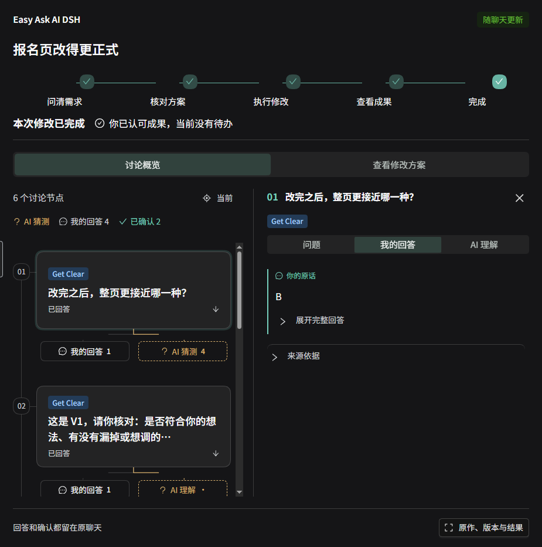

# Easy Ask AI DSH

> **本插件基于 [Easy Ask AI Skill](https://github.com/Ww-Cooooo/easy-ask-ai) 改编，专为 DeepSeek Harness 开发。**
>
> **其他 Agent 用户：** 可[安装原版 Easy Ask AI Skill](https://github.com/Ww-Cooooo/easy-ask-ai#安装与开始使用)，使用 Prompt Ready 与 Get Clear（需支持 Skill；不含 Harness 原生侧栏）。

**不会写提示词，也能把需求一步步说清楚。**

“做一个好看、高大上的页面。”拿到初稿后，又只说得出“不好看”“不够高级”。Easy Ask AI DSH 帮你把这些模糊的想法变成具体要求：开工前用 **Prompt Ready** 问清需求，有了成果后用 **Get Clear** 问清怎么改，整理成方案，等你确认后再动手。你负责表达感受和选择，不必先学会专业术语。

这是社区独立开发的**非官方 DeepSeek Harness 原生插件**。提问、回答和确认都留在原聊天里，右栏展示 AI 的理解、你的回答与进度，不用先创建任务或重复填写。

依据：[两种流程的使用说明](docs/USAGE.md)、[报名页真实演示](docs/DEMO.md)。澄清与提问仍依赖模型判断，具体实测范围见下文。

## 安装

当前为 **0.4.10 公开测试版**，已验证 **Windows / DeepSeek Harness 0.2.2-rc.1**。其他 Harness 版本和操作系统尚未验证。请先在 Harness 配好支持工具调用的模型及工作区，并允许会话使用本插件的工具；完成下方文件示例还需要读取原文件、另存结果的权限。插件本身不提供模型或 Token。

报名页提问环节记录的模型配置名称为 **DeepSeek V4.1 Flash / Max**；这不是其他模型已经验证或所有模型都能按流程执行的保证。

1. 在 Harness 打开 **插件 → 添加插件**，粘贴下面的固定版本地址并安装、启用。也可以从 [Release 页面](https://github.com/Ww-Cooooo/easy-ask-ai-dsh/releases/tag/v0.4.10) 下载 `.tgz` 后选择本地安装。

   ```text
   https://github.com/Ww-Cooooo/easy-ask-ai-dsh/releases/download/v0.4.10/eh3-dsh-easy-ask-ai-0.4.10.tgz
   ```

2. 打开工作区内的一条普通聊天，点输入栏附近的 **查看本次对话**。出现 Easy Ask AI DSH 右栏，即可查看已有讨论；后续消息会同步更新。
3. 试用时可将 [报名页原文](examples/registration/registration-original.md) 保存到自己的工作区，在原聊天说：“请看 registration-original.md，这个报名页不够正式。”等 AI 提问后，按自己的真实想法回答。

安装可能联网取得依赖。如果管理器提示需要重启，请保存输入后按提示重启；更新时安装新版本包，工作区记录继续保留。命令行的独立测试配置安装方法见 [INSTALL.md](docs/INSTALL.md)。

本插件与原版 Skill 独立安装、更新；使用本插件不要求先装 Skill。

## Prompt Ready：把“许愿式”需求变成执行方案

当你只说“想要一个好看、高大上的页面”，页面给谁看、希望对方做什么、什么感觉才算合适，都可能还没说清。Prompt Ready 引导模型结合已有材料追问，逐步补齐目标、内容、限制和验收标准；已有答案直接沿用，不让你重新填一遍。

问清后，AI 整理完整需求和实施方案，请你核对是否符合想法、是否有遗漏。补充后更新方案，获得你对当前版本的确认，再在原聊天继续执行。明确的小任务不需要硬走一套长访谈。

依据：[会话接入规则](src/host.mjs)、[使用说明](docs/USAGE.md)。Prompt Ready 尚无与下方报名页同范围的真人完整流程验收。

## Get Clear：把“不够高级”变成具体改法

有了初稿，你可能知道哪里不满意，却说不出专业原因。Get Clear 引导模型先看当前作品，找到需要辨清的地方，再一次问一个你能回答的具体问题。

以报名页为例，AI 可以结合标题、正文或报名说明，帮你辨认“不够正式”是措辞太像促销，还是信息表达不合适；你回答后，它继续弄清想要的感受、必须保留的信息和不接受的方向。具体问哪里由作品和反馈决定，不是固定把所有模块问一遍。

这些回答会整理成修改方案，写清改什么、保留什么，以及怎样检查。你核对并确认当前版本后，模型才按这个范围修改；看到结果后，是否符合预期仍由你判断。已明确的小改直接执行，不为澄清而反复提问。

依据：[报名页真实演示与修改结果](docs/DEMO.md)、[版本和认可检查](VALIDATION.md)。

## 右栏让问清楚的过程看得见

- **先看整场讨论，再看细节。** 节点概览突出当前内容，点节点查看问题、回答和 AI 理解；普通回复默认收起，侧栏可以拖宽，布局随宽度调整。
- **把猜测和确认分开。** Get Clear 用蓝色、Prompt Ready 用紫色标签说明流程来源；琥珀色问号表示 AI 猜测，绿色勾号说明已确认的具体方案或成果。历史来源不足时会明确标注，不凭回复提到某个名称就认定使用过。
- **知道现在轮到谁。** 顶部按“问清需求 → 核对方案 → 执行修改 → 查看成果 → 完成”显示阶段，并说明当前该回答、核对还是等待执行。查看历史节点不会让整体进度倒退。
- **确认的是具体版本。** 报告保留修改项、保留项、排除范围和验收要求，可以编辑、比较版本或导出。插件核验原聊天里的真实认可；V1 的认可不会授权 V2 新增的要求。模型完成后登记实际文件，效果是否符合预期仍由你判断。

依据：[报名页真实演示](docs/DEMO.md)、[使用说明](docs/USAGE.md)、[验证范围](VALIDATION.md)及仓库中的业务测试。模型是否需要澄清、怎样提问仍依赖模型判断；明确的小改不应强制进入长访谈。插件只校验自己的执行路径，不拦截 Harness 中所有其他工具。

## 看一次真实演示

报名页原来使用“好玩又有料”“冲就对了”等表达。DeepSeek 问整页应接近哪一种，使用者选择了 **B：正式但亲切的邀请**；随后核对方案、授权修改，最后查看新文件并回答“都对了”。原文件保留，日期、地点和报名方式没有改动。

[查看真实界面、原文和修改结果 →](docs/DEMO.md)



演示使用虚构报名材料，回答、模型执行与成果认可来自实际 Harness 会话。公开素材只保留该测试的必要片段，不包含完整聊天日志、账号、其他对话或机器路径。界面拍摄于 0.4.8。0.4.10 保留该侧栏与业务流程，修复新建空白聊天的入口按钮被输入框遮挡，并整理公开分发材料。

## 数据与权限

需求记录保存在工作区的 `.prompt-ready/<任务标识>/eh3-easy-ask-ai/`，Harness 插件存储保存索引和回执。模型接入澄清后，相关历史、原作摘录、路径、报告和认可范围会进入 Harness 会话，由你配置的模型服务处理；插件不读取模型账号密钥。打开侧栏本身不发送新模型请求，也不自动创建任务。已经接入需求流程的聊天会持续同步后续用户消息到工作区记录，关闭侧栏或本轮完成不会停止；停用插件后停止实时同步，重新启用后可能补读历史。

“认可修改方案”是业务范围确认，不能替代 Harness 的工具权限或系统审批。停用、卸载会保留原作、结果和需求记录；备份或清理方法及其他数据位置见 [使用说明](docs/USAGE.md#数据失败与卸载)。

## 开发与验证

源码与运行产物都在本仓库；普通使用者安装 Release 包即可。开发需要 Node.js ≥24.9.0：

```sh
npm ci
npm run typecheck
npm test
npm run build
```

Host 服务和 Agent 工具共用业务实现；Client 使用 Harness 原生 React 扩展和官方 Remote 接口，React、Cordis 由宿主共享。无独立网页或 iframe。

测试覆盖版本、来源、认可、会话隔离、投递重试、结果评价与进度。真实模型演示、自动化测试、历史记录回放的范围分别列在 [VALIDATION.md](VALIDATION.md)。欢迎通过 [Issues](https://github.com/Ww-Cooooo/easy-ask-ai-dsh/issues) 提交复现步骤；请先移除密钥、私人聊天和个人资料。

本项目代码采用 [MIT](LICENSE)。方法来源及各依赖、字体的许可见 [NOTICE.md](NOTICE.md)；GSAP 使用其 Standard License，不能将所有打包依赖统称 MIT。

## 发布与维护

所有已核实的发布入口、市场投稿状态和后续同步步骤集中在 [发布渠道与同步维护](RELEASE-CHANNELS.md)。修改介绍、安装包或截图时，请按清单逐项检查，并记录各处的实际更新结果。
