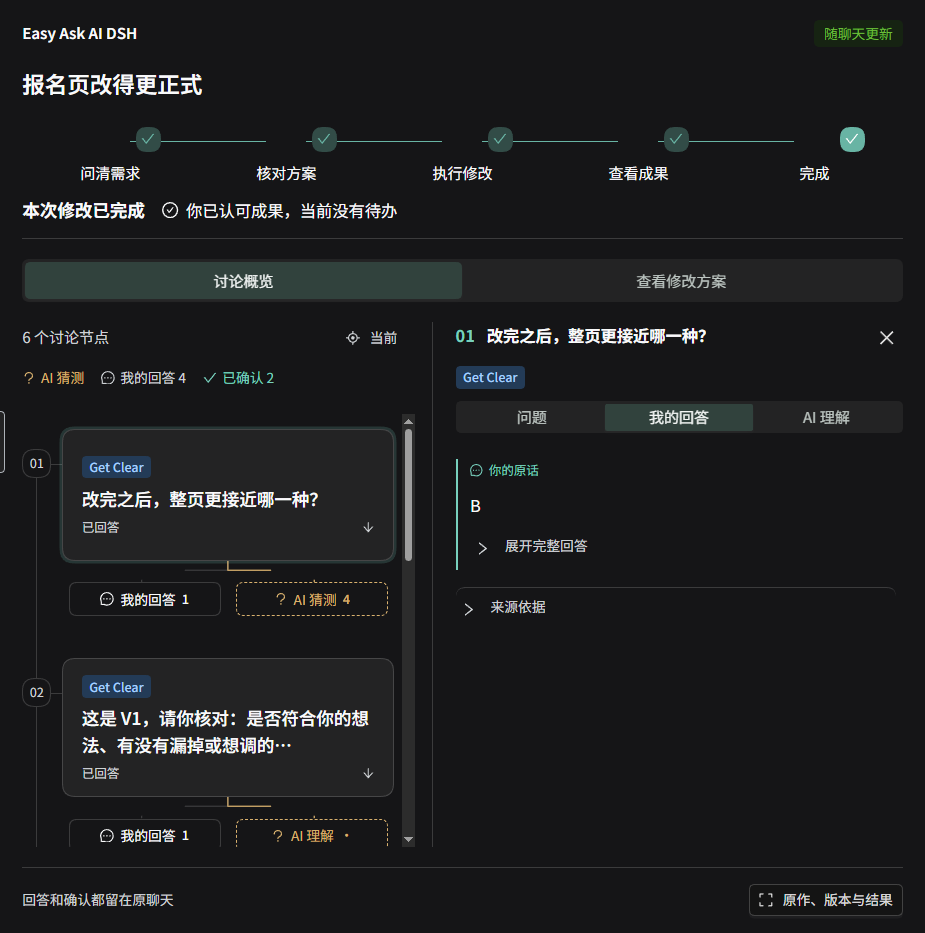

# 报名页真实演示

[返回项目首页](../README.md)

这次演示在实际 DeepSeek Harness 中完成：DeepSeek 提问，使用者亲自回答、核对方案并评价成果。材料是虚构报名页，无真实报名数据。下面只摘录理解这个流程需要的内容，不公开完整会话日志或私人工作区。

## 从“不够正式”问清方向

原文标题是“快来一起玩转新技能！”，导语包含“好玩又有料”“冲就对了”。[查看原文件](../examples/registration/registration-original.md)。

DeepSeek 问：“改完之后，整页更接近哪一种？”给出的方向包括正式通知、正式但亲切的邀请、简洁活动海报，以及都不是／说不清。使用者选择 **B：正式但亲切的邀请**。

问题、回答和 AI 的整理分别保存在原聊天与插件记录中。回答 B 是对风格问题的回答，不能直接当作认可一整份修改方案。

## 核对方案后再修改

模型展示具体修改方案，使用者回复“符合”，并明确说“就按这个方向改”。本轮最终执行依据为 V2：调整标题和导语，保留日期、时间、地点、报名方式及截止时间，不增加主办方、联系人或报名链接，另存新文件。已确认范围还明确约定：末尾“（无私密信息的插件验证样例）”只留在原文件，不复制进新页面。

这条真实记录也保留了开发期间的重复确认：早期版本漏记自然语言认可，修复后从原始用户消息恢复依据，继续原范围执行。演示没有删除这段历史，也没有把修复通知当成使用者回答。

## 查看成果，再确认效果

DeepSeek 生成了 [registration-formal.md](../examples/registration/registration-formal.md)：

> 邀你一起玩转新技能
>
> 名额有限，欢迎报名参加。在这里体验数据分析和智能工具的入门方法。

时间、地点和报名方式三行保持原样，原文件未改动。模型交付后，使用者查看结果并回答“都对了”；插件将其绑定到这份实际成果，整体进度显示完成，下一步显示“你已认可成果，当前没有待办”。普通收尾回复默认收起。

截图来自正在使用的真实原生客户端，不是生成的产品效果图。只截取本插件区域，截图时隐藏了无关悬浮组件，没有修改问题、回答、确认或进度。它展示已结束流程的回看；不是把历史记录播放成一次新的实时模型执行。界面拍摄于 0.4.8。0.4.10 保留该侧栏与业务流程，另修复新建空白聊天时入口按钮被输入框遮挡的问题，并整理公开分发材料。

## 自己试一次

把原文件复制到自己的 Harness 工作区，打开普通聊天，说“请看 registration-original.md，这个报名页不够正式”。点“查看本次对话”，观察当前问题、自己的回答与 AI 理解。按真实想法回答；看到方案后再决定是否修改，看到成果后再评价。不要把本页的 B 或“都对了”当作自己的默认答案。

本案例验证了 Get Clear 的一条真实流程，不代表所有模型、所有模糊反馈或 Prompt Ready 新任务流程都经过同样的真人验收。完整技术边界见 [验证范围](../VALIDATION.md)。
